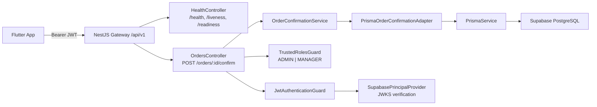

# 📊 Báo Cáo Tiến Độ Backend — `feature/backend-nestjs-init`

> **Ngày cập nhật:** 18/11/2026
> **Nhiệm vụ vừa hoàn thành:** Wire OrdersModule — Tạo REST API endpoint `POST /api/v1/orders/:id/confirm`

---

## ✅ Nhiệm vụ đã thực hiện

### Wire OrdersModule — Kết nối toàn bộ NestJS Dependency Injection

Đây là bước quan trọng nhất chuyển backend từ trạng thái "offline contract" (tất cả logic viết xong nhưng chưa kết nối) sang **API endpoint hoạt động thực sự**.

#### Các file đã tạo mới

| File | Mục đích |
|---|---|
| [`backend/src/auth/auth.module.ts`](file:///c:/E/hk7/cd4/project/InventoryAssistant/backend/src/auth/auth.module.ts) | NestJS Module đăng ký `SupabasePrincipalProvider` ↔ `VERIFIED_PRINCIPAL_PROVIDER` với JWKS verification, inject `SUPABASE_URL` từ ConfigService |
| [`backend/src/orders/orders.module.ts`](file:///c:/E/hk7/cd4/project/InventoryAssistant/backend/src/orders/orders.module.ts) | NestJS Module wire `PrismaOrderConfirmationAdapter` → `OrderConfirmationService` → `OrdersController` |
| [`backend/src/orders/orders.controller.ts`](file:///c:/E/hk7/cd4/project/InventoryAssistant/backend/src/orders/orders.controller.ts) | REST Controller: `POST /api/v1/orders/:orderId/confirm` với Swagger docs, Auth guards, Validation pipe |
| [`backend/src/orders/dto/confirm-order.dto.ts`](file:///c:/E/hk7/cd4/project/InventoryAssistant/backend/src/orders/dto/confirm-order.dto.ts) | Request/Response DTOs với class-validator decorators |

#### Các file đã sửa

| File | Thay đổi |
|---|---|
| [`backend/src/app.module.ts`](file:///c:/E/hk7/cd4/project/InventoryAssistant/backend/src/app.module.ts) | Import `OrdersModule` vào AppModule |
| [`backend/src/app.module.spec.ts`](file:///c:/E/hk7/cd4/project/InventoryAssistant/backend/src/app.module.spec.ts) | Fix test: dùng inline ConfigModule với test env thay vì import AppModule (decorator-time validation issue) |
| [`backend/test/app.e2e-spec.ts`](file:///c:/E/hk7/cd4/project/InventoryAssistant/backend/test/app.e2e-spec.ts) | Fix E2E test: tạo TestAppModule với inline config; thêm test 401 cho orders endpoint |

#### Các file test mới

| File | Test cases |
|---|---|
| [`backend/src/auth/auth.module.spec.ts`](file:///c:/E/hk7/cd4/project/InventoryAssistant/backend/src/auth/auth.module.spec.ts) | 2 tests: wiring SupabasePrincipalProvider, throw khi thiếu SUPABASE_URL |
| [`backend/src/orders/orders.controller.spec.ts`](file:///c:/E/hk7/cd4/project/InventoryAssistant/backend/src/orders/orders.controller.spec.ts) | 9 tests: applied, replay, conflict, in_progress, expired, domain errors, missing principal |
| [`backend/src/orders/orders.module.spec.ts`](file:///c:/E/hk7/cd4/project/InventoryAssistant/backend/src/orders/orders.module.spec.ts) | 1 test: module compilation và DI wiring |

---

## 🧪 Kết quả Quality Gates

| Gate | Kết quả |
|---|:---:|
| `npx vitest run` (Unit Tests) | ✅ **21/21 files, 92/92 tests PASS** |
| `npx vitest run --config vitest.config.e2e.ts` (E2E) | ✅ **1/1 file, 6/6 tests PASS** |
| `npx tsc --noEmit -p tsconfig.json` | ✅ **PASS** |
| `npx eslint "{src,test}/**/*.ts"` | ✅ **PASS** |
| `npx prisma validate` / `npx prisma generate` | ✅ **PASS** |

---

## 📊 Bảng đánh giá tiến độ tổng thể Backend (Cập nhật 18/11/2026)

| Phân hệ / Hạng mục | Trọng số | Tỷ lệ hoàn thành | Tình trạng |
|:---|:---:|:---:|:---|
| **NestJS Scaffolding & Tooling** | 10% | **100%** | Config, Swagger, Health, Linter, Vitest ✅ |
| **Prisma Schema & Database Design** | 15% | **95%** | Schema aligned, migration candidate 001 staging ✅ |
| **Auth & Security Foundation** | 15% | **95%** | SupabasePrincipalProvider, Guards, **AuthModule wired** ✅ |
| **Inventory Contract (Business Logic)** | 20% | **85%** | Contract + adapters xong, chưa tạo endpoint riêng cho movements |
| **Order Confirmation API** | 15% | **70%** | **Controller + Module wired → endpoint hoạt động** ✅; chưa test live với DB |
| **API Endpoints (các endpoint khác)** | 15% | **25%** | Mới có Health + Orders confirm; chưa có Products/Locations/Inventory CRUD |
| **Integration Testing (DB live)** | 10% | **15%** | Harness dựng xong, tất cả cases NOT RUN (cần test project riêng) |
| **TỔNG THỂ BACKEND** | **100%** | **~70%** | **Từ ~60% lên ~70% sau khi wire OrdersModule** |

---

## 📝 Các việc cần làm tiếp theo (Backlog ưu tiên)

### Ưu tiên cao (tiếp theo nên làm)

1. **Tạo Products CRUD Controller** (`GET /products`, `GET /products/:id`, `POST /products`, `PUT /products/:id`, `DELETE /products/:id`)
   - Wire trực tiếp Prisma queries qua ProductsService
   - Guard: `@RequireTrustedRoles('ADMIN', 'MANAGER')` cho write, public read cho authenticated

2. **Tạo Locations CRUD Controller** (`GET /locations`, `POST /locations`, `PUT /locations/:id`, `DELETE /locations/:id`)
   - Tương tự pattern Products

3. **Tạo Inventory Movements Endpoint** (`POST /inventory/receive`, `POST /inventory/ship`)
   - Wire `InventoryCommandService` và `PrismaInventoryTransactionAdapter`
   - Cần `VerifiedPrincipalProvider` đã sẵn sàng

### Ưu tiên trung bình

4. **Tạo Orders List/Detail** (`GET /orders`, `GET /orders/:id`)
5. **Phân trang server-side** (cursor-based pagination cho danh sách lớn)
6. **Stock Ledger Query Endpoint** (`GET /inventory/:itemId/ledger`) — phục vụ báo cáo biến động

### Ưu tiên thấp (cần Owner approval)

7. **Apply migration 001 lên test project** → chạy `npm run test:db`
8. **Backup restore verification**
9. **Triển khai lên Supabase Cloud Development**

---

## 🏗️ Kiến trúc API hiện tại

