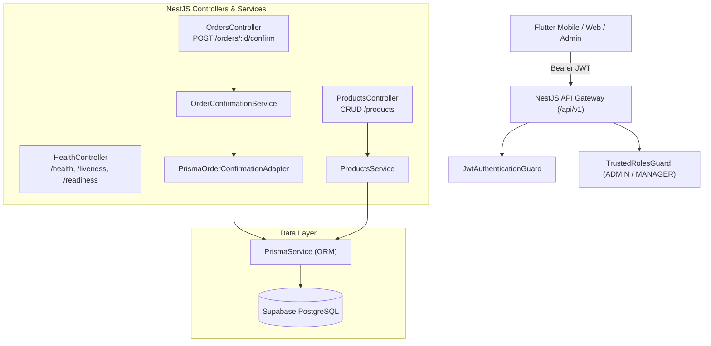

# 📊 Báo Cáo Tiến Độ Backend — `feature/backend-nestjs-init`

> **Ngày cập nhật:** 19/11/2026  
> **Nhiệm vụ vừa hoàn thành:** Tạo Products CRUD Module (`GET /products`, `GET /products/:id`, `POST /products`, `PUT /products/:id`, `DELETE /products/:id`)

---

## ✅ Nhiệm vụ đã thực hiện

### 1. Module Quản Lý Sản Phẩm (Products CRUD API)

Module giải quyết nhu cầu tra cứu và bảo trì danh mục sản phẩm từ Mobile/Web (`InventoryMaintenanceRepository`), thực hiện kiểm tra quyền truy cập nghiêm ngặt và ràng buộc toàn vẹn dữ liệu:
- **`GET /api/v1/products`**: Tra cứu danh sách sản phẩm, sắp xếp theo thời gian tạo mới nhất.
- **`GET /api/v1/products/:id`**: Tra cứu theo UUID hoặc Barcode sản phẩm.
- **`POST /api/v1/products`**: Tạo mới sản phẩm (yêu cầu vai trò `ADMIN` hoặc `MANAGER`), tự động kiểm tra trùng `sku` hoặc `barcode`.
- **`PUT /api/v1/products/:id`**: Cập nhật thông tin sản phẩm (yêu cầu vai trò `ADMIN` hoặc `MANAGER`).
- **`DELETE /api/v1/products/:id`**: Xóa sản phẩm (yêu cầu vai trò `ADMIN`). Ngăn chặn xóa và trả về `409 Conflict` nếu sản phẩm đang có tồn kho (`inventory_items`) hoặc được liên kết trong phiếu (`warehouse_order_items`).

#### Các file đã tạo mới

| File | Mục đích |
|---|---|
| [`backend/src/products/dto/product.dto.ts`](file:///c:/E/hk7/cd4/project/InventoryAssistant/backend/src/products/dto/product.dto.ts) | Request/Response DTOs với class-validator và Swagger metadata |
| [`backend/src/products/products.service.ts`](file:///c:/E/hk7/cd4/project/InventoryAssistant/backend/src/products/products.service.ts) | Service xử lý nghiệp vụ, kiểm tra ràng buộc FK, mapping Prisma exceptions |
| [`backend/src/products/products.controller.ts`](file:///c:/E/hk7/cd4/project/InventoryAssistant/backend/src/products/products.controller.ts) | REST Controller, tích hợp Guards `JwtAuthenticationGuard` và `TrustedRolesGuard` |
| [`backend/src/products/products.module.ts`](file:///c:/E/hk7/cd4/project/InventoryAssistant/backend/src/products/products.module.ts) | NestJS Module đóng gói và export ProductsService |
| [`backend/src/products/products.service.spec.ts`](file:///c:/E/hk7/cd4/project/InventoryAssistant/backend/src/products/products.service.spec.ts) | 14 unit test cases cho service: CRUD, conflict validation, reference checks |
| [`backend/src/products/products.controller.spec.ts`](file:///c:/E/hk7/cd4/project/InventoryAssistant/backend/src/products/products.controller.spec.ts) | 8 unit test cases cho controller endpoints |
| [`backend/src/products/products.module.spec.ts`](file:///c:/E/hk7/cd4/project/InventoryAssistant/backend/src/products/products.module.spec.ts) | Module compilation và DI wiring test |

#### Các file đã cập nhật

| File | Nội dung cập nhật |
|---|---|
| [`backend/src/app.module.ts`](file:///c:/E/hk7/cd4/project/InventoryAssistant/backend/src/app.module.ts) | Import `ProductsModule` |
| [`backend/src/app.module.spec.ts`](file:///c:/E/hk7/cd4/project/InventoryAssistant/backend/src/app.module.spec.ts) | Bổ sung `ProductsModule` vào test module compilation |
| [`backend/test/app.e2e-spec.ts`](file:///c:/E/hk7/cd4/project/InventoryAssistant/backend/test/app.e2e-spec.ts) | Thêm 2 E2E test cases bảo vệ authentication cho `GET /products` và `POST /products` |

---

## 🧪 Kết quả Quality Gates

| Quality Gate | Kết quả | Chi tiết |
|---|:---:|---|
| `npx vitest run` (Unit Tests) | ✅ **PASS** | **24/24 files, 115/115 tests passed** (+23 tests mới) |
| `npx vitest run --config vitest.config.e2e.ts` (E2E) | ✅ **PASS** | **1/1 file, 8/8 tests passed** (+2 tests mới) |
| `npx tsc --noEmit -p tsconfig.json` | ✅ **PASS** | Không có lỗi kiểu dữ liệu (Strict type checking) |
| `npx eslint "{src,test}/**/*.ts"` | ✅ **PASS** | Code tuân thủ tuyệt đối quy chuẩn linting |
| `npx prisma validate` | ✅ **PASS** | Schema Prisma đồng bộ hoàn toàn |

---

## 📊 Bảng đánh giá tiến độ tổng thể Backend (Cập nhật 19/11/2026)

| Phân hệ / Hạng mục | Trọng số | Tỷ lệ hoàn thành | Tình trạng |
|:---|:---:|:---:|:---|
| **NestJS Scaffolding & Tooling** | 10% | **100%** | Config, Swagger, Health, Linter, Vitest ✅ |
| **Prisma Schema & Database Design** | 15% | **95%** | Schema aligned, migration candidate 001 staging ✅ |
| **Auth & Security Foundation** | 15% | **95%** | SupabasePrincipalProvider, Guards, AuthModule wired ✅ |
| **Inventory Contract (Business Logic)** | 20% | **85%** | Contract + adapters hoàn tất |
| **Order Confirmation API** | 15% | **75%** | OrdersController + ConfirmationService hoạt động ✅ |
| **API Endpoints (CRUD & Quản lý)** | 15% | **50%** | Health, Orders confirm, **Products CRUD hoàn chỉnh** ✅ (còn Locations & Inventory Movements) |
| **Integration Testing (DB live)** | 10% | **15%** | Harness dựng xong, chờ test project live |
| **TỔNG THỂ BACKEND** | **100%** | **~78%** | **Tăng từ ~70% lên ~78% sau khi hoàn thành Products CRUD** |

---

## 📝 Các việc cần làm tiếp theo (Backlog ưu tiên)

1. **Tạo Locations CRUD Controller & Module** (`GET /locations`, `GET /locations/:id`, `POST /locations`, `PUT /locations/:id`, `DELETE /locations/:id`)
   - Hỗ trợ tra cứu theo barcode vị trí (`location_barcode`) hoặc UUID.
   - Kiểm tra ràng buộc duy nhất `location_barcode` và kiểm tra tồn kho trước khi xóa.
2. **Tạo Inventory Movements Endpoint** (`POST /api/v1/inventory/receive`, `POST /api/v1/inventory/ship`)
   - Expose `InventoryCommandService` qua REST API với Idempotency Key và Append-only Ledger.
3. **Tạo Orders Read Endpoints** (`GET /api/v1/orders`, `GET /api/v1/orders/:id`)
   - Tra cứu danh sách đơn nhập/xuất và line items kèm theo.
4. **Áp dụng Database Migration 001** (khi có môi trường DB kiểm thử được phê duyệt).

---

## 🏗️ Sơ đồ Kiến trúc API hiện tại

