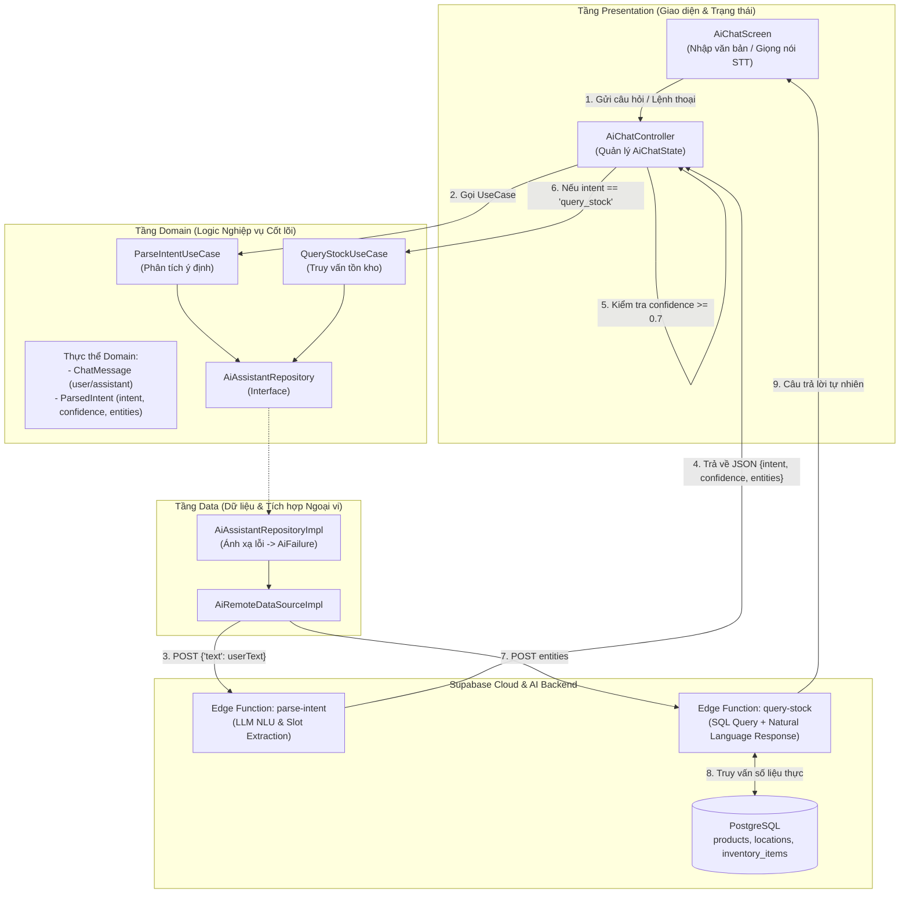
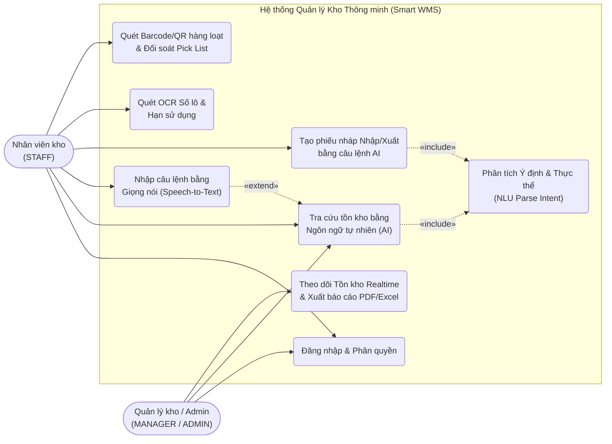
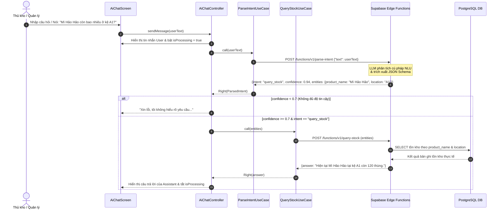

# NỘI DUNG BÁO CÁO ĐỒ ÁN (CHUẨN BỐ CỤC WORD VKU)

> [!TIP]
> Toàn bộ nội dung dưới đây được biên soạn khớp 100% với bố cục file Word gốc của nhóm (Bìa, Lời cảm ơn, Mục lục, Chương 1, Chương 2, Chương 3, Kết luận, Tài liệu tham khảo) nhưng đã được **viết mới hoàn toàn cho dự án Smart WMS (Inventory Assistant)** với **trọng tâm cốt lõi là phân hệ Trợ lý AI (AI Assistant)**. Bạn có thể sao chép trực tiếp từng phần vào file Word mẫu của trường.

---

## TRANG BÌA & TRANG PHỤ BÌA

**TRƯỜNG ĐẠI HỌC CÔNG NGHỆ THÔNG TIN & TRUYỀN THÔNG VIỆT – HÀN**
**KHOA KHOA HỌC MÁY TÍNH**
-----🙞🙜🕮🙞🙜-----

*(Logo VKU)*

**AI FOR LIFE / AI PRODUCT**
### XÂY DỰNG HỆ THỐNG QUẢN LÝ KHO HÀNG THÔNG MINH TÍCH HỢP TRỢ LÝ ẢO AI ĐA PHƯƠNG THỨC (SMART WMS – INVENTORY ASSISTANT)

**Sinh viên thực hiện:**
- Nguyễn Thành Thịnh – 23IT262
- Huỳnh Văn Huy – 23IT100
- Nguyễn Văn Huy Hoàng – 23IT089
- Dương Khánh Hòa – 23IT081
- Nguyễn Văn Hội – 23IT091

**Đà Nẵng, năm 2026**

---

## LỜI NHẬN XÉT
*(Của giảng viên hướng dẫn)*

................................................................................................................................................................
................................................................................................................................................................
................................................................................................................................................................
................................................................................................................................................................

*Đà Nẵng, tháng ... năm 2026*

---

## LỜI CẢM ƠN

Chúng em xin gửi lời cảm ơn chân thành đến Ban Giám hiệu Trường Đại học Công nghệ Thông tin và Truyền thông Việt – Hàn (VKU) cùng quý thầy cô Khoa Khoa học Máy tính đã tạo điều kiện thuận lợi, truyền đạt những kiến thức nền tảng và chuyên sâu để sinh viên có cơ hội vận dụng Trí tuệ nhân tạo (AI) vào việc xây dựng các sản phẩm công nghệ giải quyết bài toán thực tiễn của doanh nghiệp và đời sống.

Trong quá trình thực hiện đề tài **“Xây dựng hệ thống quản lý kho hàng thông minh tích hợp Trợ lý ảo AI đa phương thức (Smart WMS – Inventory Assistant)”**, nhóm chúng em đã nhận được sự hướng dẫn tận tình, những ý kiến định hướng chuyên môn quý báu từ giảng viên hướng dẫn. Nhờ đó, nhóm đã biết cách kết hợp các công nghệ AI hiện đại — bao gồm Xử lý ngôn ngữ tự nhiên (NLU/LLM), Nhận diện giọng nói (Speech-to-Text) và Thị giác máy tính trên thiết bị di động (On-device OCR) — vào một kiến trúc phần mềm chuẩn mực (Clean Architecture).

Bên cạnh đó, chúng em cũng xin cảm ơn các bạn đồng môn và các anh chị đi trước đã chia sẻ kinh nghiệm thực tế về phát triển ứng dụng đa nền tảng với Flutter, xây dựng dịch vụ đám mây với Supabase Edge Functions và thiết kế luồng hội thoại AI an toàn (Human-in-the-loop).

Mặc dù nhóm đã nỗ lực nghiên cứu và hoàn thiện sản phẩm một cách nghiêm túc, báo cáo khó tránh khỏi những thiếu sót nhất định. Chúng em rất mong nhận được những ý kiến đóng góp quý báu từ quý thầy cô để hệ thống ngày càng hoàn thiện hơn.

Chúng em xin chân thành cảm ơn!

---

## MỤC LỤC

- **LỜI NHẬN XÉT**
- **LỜI CẢM ƠN**
- **MỤC LỤC**
- **DANH MỤC HÌNH ẢNH & BẢNG BIỂU**
- **GIỚI THIỆU**
- **CHƯƠNG 1: TỔNG QUAN ĐỀ TÀI**
  - 1.1. Lý do chọn đề tài
  - 1.2. Mục tiêu đề tài
  - 1.3. Ngôn ngữ, công nghệ và công cụ lập trình
    - 1.3.1. Flutter & Ngôn ngữ Dart (Clean Architecture & Riverpod)
    - 1.3.2. Nền tảng Backend Supabase & Supabase Edge Functions
    - 1.3.3. Mô hình ngôn ngữ lớn (LLM) & Kỹ thuật hiểu ngôn ngữ tự nhiên (NLU)
    - 1.3.4. Google ML Kit (On-device OCR & Barcode/QR Scanning)
    - 1.3.5. Công nghệ nhận diện giọng nói (Speech-to-Text)
    - 1.3.6. Visual Studio Code, Postman & Figma
  - 1.4. Kết luận Chương 1
- **CHƯƠNG 2: PHÂN TÍCH VÀ THIẾT KẾ HỆ THỐNG**
  - 2.1. Mô tả tổng thể hệ thống và Kiến trúc Trợ lý AI
    - 2.1.1. Kiến trúc tổng thể hệ thống
    - 2.1.2. Kiến trúc chuyên sâu của phân hệ Trợ lý AI (AI Assistant Pipeline)
  - 2.2. Yêu cầu hệ thống
    - 2.2.1. Yêu cầu chức năng (Trọng tâm phân hệ Trợ lý AI & Tự động hóa kho)
    - 2.2.2. Yêu cầu phi chức năng
  - 2.3. Xác định các trường hợp sử dụng (Use Case)
    - 2.3.1. Biểu đồ Use Case tổng thể và phân rã Trợ lý AI
    - 2.3.2. Biểu đồ trình tự (Sequence Diagram) luồng xử lý Trợ lý AI
- **CHƯƠNG 3: THỰC NGHIỆM VÀ KẾT QUẢ ĐÁNH GIÁ**
  - 3.1. Kịch bản thực nghiệm và đánh giá hệ thống AI
  - 3.2. Kết quả đánh giá phân hệ Trợ lý AI (NLU Intent Classification & Entity Extraction)
  - 3.3. Kết quả đánh giá mô-đun OCR nhận diện Số lô (LOT) và Hạn sử dụng (EXP)
  - 3.4. Minh họa kết quả triển khai ứng dụng thực tế
- **KẾT LUẬN**
  - 1. Kết quả đã thực hiện được
  - 2. Hạn chế của đề tài
  - 3. Hướng phát triển trong tương lai
- **DANH SÁCH THAM KHẢO**

---

## DANH MỤC HÌNH ẢNH & BẢNG BIỂU

- **Hình 1:** Kiến trúc Clean Architecture và luồng xử lý của Trợ lý AI trong Smart WMS
- **Hình 2:** Biểu đồ Use Case tổng thể hệ thống Smart WMS và phân hệ Trợ lý AI
- **Hình 3:** Biểu đồ trình tự (Sequence Diagram) quá trình phân tích ý định và truy vấn tồn kho của Trợ lý AI
- **Hình 4:** Ma trận nhầm lẫn (Confusion Matrix) trên tập kịch bản kiểm thử phân loại ý định (Intent Classification)
- **Hình 5:** Biểu đồ so sánh độ chính xác trích xuất thực thể (Slot Filling F1-Score) theo loại thực thể kho hàng
- **Hình 6:** Giao diện màn hình hội thoại Trợ lý AI (`AiChatScreen`) và các chức năng nghiệp vụ trên ứng dụng
- **Bảng 1:** Bảng so sánh các phương pháp thiết kế NLU cho Trợ lý AI kho hàng
- **Bảng 2:** Kết quả đánh giá độ chính xác nhận diện Ý định (Intent) và Thực thể (Entities) của Trợ lý AI
- **Bảng 3:** Kết quả đánh giá tốc độ và độ chính xác nhận diện ký tự quang học (OCR) cho Số lô và Hạn sử dụng

---

## GIỚI THIỆU

Trong bối cảnh chuyển đổi số mạnh mẽ của ngành chuỗi cung ứng và hậu cần (Logistics), quản lý kho hàng (Warehouse Management System – WMS) đóng vai trò là mắt xích sống còn quyết định hiệu suất vận hành của doanh nghiệp. Tuy nhiên, tại phần lớn các kho hàng vừa và nhỏ hiện nay, quy trình tra cứu tồn kho, kiểm đếm, nhập liệu số lô (Lot Number), hạn sử dụng (Expiry Date) và lập phiếu nhập/xuất vẫn phụ thuộc nhiều vào thao tác nhập biểu mẫu thủ công trên màn hình phức tạp hoặc sổ sách giấy tờ. Khi nhân viên thủ kho đang trực tiếp khuân vác, phân loại hoặc kiểm tra hàng hóa trên kệ, việc phải dừng tay để gõ tìm kiếm từng mã SKU hay điền hàng loạt trường thông tin trên điện thoại gây mất thời gian, giảm năng suất và dễ dẫn đến sai sót dữ liệu.

Sự phát triển đột phá của Trí tuệ nhân tạo (AI) trong những năm gần đây — đặc biệt là **Xử lý ngôn ngữ tự nhiên dựa trên Mô hình ngôn ngữ lớn (LLM/NLU)**, **Nhận diện giọng nói (Speech-to-Text)** và **Thị giác máy tính trên thiết bị di động (On-device OCR)** — đã mở ra một hướng tiếp cận hoàn toàn mới: **biến ứng dụng quản lý kho từ một công cụ nhập liệu thụ động thành một Trợ lý ảo thông minh (AI Assistant) có khả năng giao tiếp tự nhiên với con người.**

Xuất phát từ thực tiễn đó, nhóm thực hiện đề tài **“Xây dựng hệ thống quản lý kho hàng thông minh tích hợp Trợ lý ảo AI đa phương thức (Smart WMS – Inventory Assistant)”**. Điểm nhấn cốt lõi của hệ thống là phân hệ **Trợ lý AI kho hàng** cho phép thủ kho và người quản lý tương tác trực tiếp bằng văn bản hoặc giọng nói tiếng Việt tự nhiên (ví dụ: *"Mì Hảo Hảo còn bao nhiêu ở kệ A1?"* hoặc *"Nhập 50 thùng nước khoáng vào kệ B2"*). Hệ thống sử dụng AI để phân tích ý định (Intent Parsing), trích xuất các thực thể nghiệp vụ (Entity/Slot Extraction), tự động truy vấn cơ sở dữ liệu tồn kho theo thời gian thực để trả lời chính xác, hoặc tự động khởi tạo bản nháp phiếu nhập/xuất kho (Draft Order) đi kèm cơ chế kiểm duyệt an toàn của con người (Human-in-the-loop). Bên cạnh đó, hệ thống còn tích hợp AI nhận diện chữ viết quang học (OCR) để đọc tự động Số lô và Hạn sử dụng trên bao bì sản phẩm cùng khả năng quét Barcode/QR hàng loạt.

---

## CHƯƠNG 1: TỔNG QUAN ĐỀ TÀI

### 1.1. Lý do chọn đề tài

Trong môi trường làm việc thực tế tại nhà kho, nhân viên kho (Staff) và quản lý kho (Manager) thường xuyên đối mặt với ba rào cản lớn:
1. **Bất tiện khi tra cứu và thao tác trong lúc đang xử lý hàng hóa:** Thủ kho thường phải cầm hàng, đẩy xe hoặc kiểm kệ. Việc mở nhiều tầng menu, lọc theo từng bộ lọc để kiểm tra xem một mặt hàng còn bao nhiêu và nằm ở kệ nào gây gián đoạn công việc.
2. **Tốn thời gian khi tạo phiếu nhập/xuất và nhập thông tin lô hàng:** Để tạo một phiếu nhập kho, nhân viên phải chọn loại phiếu, tìm từng sản phẩm, nhập số lượng, vị trí kệ, gõ từng ký tự của Số lô (LOT) và Hạn sử dụng (EXP) in nhỏ trên vỏ thùng.
3. **Rủi ro sai lệch dữ liệu khi ứng dụng AI thiếu kiểm soát:** Nhiều hệ thống tích hợp chatbot AI thuần túy thường gặp hiện tượng "ảo giác" (Hallucination) — tự bịa ra số liệu tồn kho, hoặc nguy hiểm hơn là tự động sửa đổi cơ sở dữ liệu khi hiểu nhầm câu lệnh của người dùng.

Để giải quyết triệt để các vấn đề trên, việc xây dựng **Smart WMS – Inventory Assistant** với hạt nhân là **Trợ lý AI định hướng tác vụ (Task-oriented AI Assistant)** kết hợp cùng **OCR trên thiết bị** là vô cùng cấp thiết. Thay vì một chatbot trò chuyện chung chung, Trợ lý AI trong đề tài được thiết kế theo kiến trúc NLU có cấu trúc chặt chẽ (`ParsedIntent`), kết nối trực tiếp với dữ liệu thực tế trên Supabase (Grounding) và áp dụng nguyên tắc an toàn **Human-in-the-loop** (AI chỉ chuẩn bị bản nháp và truy vấn, con người giữ quyền xác nhận cuối cùng). Đề tài thể hiện rõ tinh thần ứng dụng AI vào sản phẩm thực tế (AI Product), giúp nâng cao năng suất lao động và giảm thiểu sai sót trong vận hành kho.

### 1.2. Mục tiêu đề tài

Mục tiêu chính của đề tài là thiết kế và xây dựng hoàn chỉnh ứng dụng di động **Smart WMS (Inventory Assistant)** theo kiến trúc Clean Architecture, trong đó tập trung giải quyết các mục tiêu trọng tâm sau:

- **Trọng tâm 1 – Xây dựng Trợ lý ảo AI kho hàng (AI Assistant):**
  - **Hiểu ngôn ngữ tự nhiên (NLU – Intent & Entity Extraction):** Phân tích câu hỏi hoặc mệnh lệnh tiếng Việt của người dùng để xác định chính xác ý định nghiệp vụ (`intent`: tra cứu tồn kho `query_stock`, tạo phiếu `create_order`, xem báo cáo `report`) kèm điểm số tin cậy (`confidence` từ `0.0` đến `1.0`) và bóc tách các thực thể kho hàng (`entities`: tên sản phẩm `product_name`, mã vị trí kệ `location`, số lượng `quantity`, đơn vị tính `unit`).
  - **Tra cứu tồn kho thông minh (Natural Language Stock Query):** Tự động chuyển đổi các thực thể bóc tách được thành truy vấn cơ sở dữ liệu chính xác trên bảng sản phẩm, vị trí và tồn kho; tổng hợp kết quả và phản hồi lại cho người dùng bằng ngôn ngữ tự nhiên, dễ hiểu.
  - **Hỗ trợ tạo phiếu nháp bằng câu lệnh tự nhiên (AI-Assisted Draft Order):** Tự động dựng bản nháp phiếu nhập/xuất kho ở trạng thái `Draft` từ câu lệnh tự nhiên, yêu cầu người dùng kiểm tra trước khi xác nhận ghi vào cơ sở dữ liệu.
  - **Giao tiếp rảnh tay bằng giọng nói (Speech-to-Text):** Cho phép nhân viên kho ra lệnh và đặt câu hỏi bằng giọng nói trực tiếp thông qua micro điện thoại.
- **Trọng tâm 2 – Ứng dụng Thị giác máy tính (On-device Computer Vision) trong Nhập/Xuất kho:**
  - Tích hợp mô hình nhận diện ký tự quang học (**Google ML Kit Text Recognition**) kết hợp thuật toán hậu xử lý biểu thức chính quy (Regex) để tự động trích xuất **Số lô (Batch/Lot Number)** và **Hạn sử dụng (Expiry Date)** từ ảnh chụp bao bì sản phẩm.
  - Hỗ trợ quét mã **Barcode/QR liên tục theo lô (Batch Scanning)** khi nhập kho và quét đối soát chống nhầm hàng khi xuất kho (Pick List Verification).
- **Trọng tâm 3 – Quản lý kho thời gian thực và Phân quyền chặt chẽ:**
  - Đồng bộ hóa số liệu tồn kho và cảnh báo tồn kho dưới mức an toàn theo thời gian thực (**Supabase Realtime**) trên Dashboard.
  - Phân quyền người dùng theo 3 vai trò (`ADMIN`, `MANAGER`, `STAFF`) nhằm bảo mật quy trình vận hành.

### 1.3. Ngôn ngữ, công nghệ và công cụ lập trình

#### 1.3.1. Flutter & Ngôn ngữ Dart (Clean Architecture & Riverpod)
Ứng dụng phía client được phát triển bằng framework **Flutter** và ngôn ngữ **Dart**, cho phép biên dịch mã máy hiệu năng cao trên cả hai nền tảng Android và iOS từ một mã nguồn duy nhất.
Trong đề tài, nhóm áp dụng:
- **Clean Architecture:** Tách biệt rõ ràng 3 tầng `presentation` (Giao diện & Controllers), `domain` (Thực thể nghiệp vụ, Hợp đồng Repository & Use Cases) và `data` (Models, Data Sources & triển khai Repository). Nhờ đó, logic của Trợ lý AI hoàn toàn độc lập với giao diện hay thư viện mạng.
- **Riverpod (`flutter_riverpod`, `riverpod_annotation`):** Quản lý trạng thái bất đồng bộ (`AsyncValue`, `AiChatState`) an toàn kiểu dữ liệu tại thời điểm biên dịch.
- **Fpdart (`Either<Failure, T>`):** Xử lý lỗi theo lập trình hàm, giúp bắt và chuyển đổi mọi ngoại lệ từ tầng AI/mạng (`AiException`, `ServerException`) thành thông báo thân thiện cho người dùng (`AiFailure`).

#### 1.3.2. Nền tảng Backend Supabase & Supabase Edge Functions
**Supabase** đóng vai trò là nền tảng Backend-as-a-Service (BaaS) toàn diện của hệ thống, bao gồm:
- **PostgreSQL Database:** Lưu trữ dữ liệu có quan hệ chặt chẽ qua các bảng `profiles`, `products`, `locations`, `inventory_items`, `warehouse_orders` và `warehouse_order_items`.
- **Supabase Auth & Row Level Security (RLS):** Xác thực người dùng và phân quyền truy cập dữ liệu theo vai trò (`ADMIN`, `MANAGER`, `STAFF`).
- **Supabase Realtime:** Phát luồng sự kiện thay đổi tồn kho tức thời tới Dashboard.
- **Supabase Edge Functions (`parse-intent`, `query-stock`):** Môi trường thực thi Serverless chạy trên nền tảng Deno ở phía đám mây, đóng vai trò là **AI Orchestration Layer** (Tầng điều phối AI) giúp bảo mật API Key của mô hình ngôn ngữ lớn, thực thi Prompt Engineering và truy vấn dữ liệu tồn kho an toàn trước khi trả kết quả về ứng dụng Flutter.

#### 1.3.3. Mô hình ngôn ngữ lớn (LLM) & Kỹ thuật hiểu ngôn ngữ tự nhiên (NLU)
Thay vì sử dụng các bộ quy tắc từ khóa cứng nhắc (Rule-based Chatbot) dễ thất bại khi người dùng diễn đạt đa dạng, phân hệ Trợ lý AI của hệ thống ứng dụng **Mô hình ngôn ngữ lớn (Large Language Model – Gemini API)** được điều khiển thông qua kỹ thuật **Structured Output Prompting (Ép khuôn đầu ra JSON)** và **Function Calling / Grounding**.
- **Tại bước NLU (`parse-intent`):** LLM đóng vai trò là bộ phân tích cú pháp ngữ nghĩa tiếng Việt, chuyển câu nói tự nhiên có nhiều cách viết tắt hoặc phương ngữ của thủ kho thành đối tượng cấu trúc gồm 3 thành phần: `intent` (ý định), `confidence` (độ tự tin của mô hình) và `entities` (danh sách cặp khóa-giá trị như `product_name`, `location`, `quantity`).
- **Tại bước Truy vấn & Sinh câu trả lời (`query-stock`):** Hệ thống kết hợp kết quả truy vấn SQL thực tế từ PostgreSQL vào ngữ cảnh để tạo câu trả lời tự nhiên (Retrieval-Augmented / Database Grounding), triệt tiêu hoàn toàn hiện tượng AI tự bịa đặt số liệu tồn kho.

#### 1.3.4. Google ML Kit (On-device OCR & Barcode/QR Scanning)
Để hỗ trợ thủ kho nhập liệu nhanh tại hiện trường mà không phụ thuộc vào tốc độ mạng khi xử lý hình ảnh, nhóm tích hợp bộ công cụ học máy trên thiết bị (**On-device Machine Learning**) của Google:
- **`google_mlkit_text_recognition`:** Nhận diện văn bản in trên nhãn bao bì sản phẩm từ camera điện thoại. Văn bản thô sau khi nhận diện được đưa qua tầng trích xuất quy tắc (`OcrScannerScreen` & Domain Use Case) để tự động phát hiện chuỗi ngày tháng (Hạn sử dụng – `EXP/HSD`) và mã lô sản xuất (`LOT/MFG`).
- **`mobile_scanner`:** Nhận diện mã vạch 1D (EAN-13, Code-128) và mã 2D (QR Code) với tốc độ khung hình cao, phục vụ quét hàng loạt khi nhập kho và đối soát khi xuất kho.

#### 1.3.5. Công nghệ nhận diện giọng nói (Speech-to-Text)
Thư viện `speech_to_text` được tích hợp vào màn hình `AiChatScreen`, cho phép thu âm giọng nói tiếng Việt (`vi_VN`) của nhân viên kho và chuyển đổi trực tiếp thành chuỗi văn bản theo thời gian thực để đưa vào bộ điều khiển `AiChatController`. Công nghệ này giúp hiện thực hóa trải nghiệm **"Hands-free Warehouse Operation"** (Vận hành kho rảnh tay).

#### 1.3.6. Visual Studio Code, Postman & Figma
- **Visual Studio Code (VS Code):** Môi trường phát triển tích hợp (IDE) chính dùng để lập trình mã nguồn Flutter/Dart, chạy trình sinh mã tự động (`build_runner`), kiểm tra chất lượng mã nguồn (`flutter analyze` với bộ quy chuẩn `very_good_analysis`) và viết kịch bản kiểm thử (`flutter test`).
- **Postman:** Công cụ kiểm thử các điểm cuối API RESTful và kiểm thử trực tiếp dữ liệu JSON đầu vào/đầu ra của các Supabase Edge Functions (`parse-intent`, `query-stock`) trước khi ghép nối vào ứng dụng di động.
- **Figma:** Công cụ thiết kế giao diện người dùng (UI/UX), giúp chuẩn hóa bố cục màn hình hội thoại Trợ lý AI, màn hình quét OCR và bảng điều khiển tồn kho trực quan, thân thiện với thao tác một tay của thủ kho.

### 1.4. Kết luận Chương 1
Chương 1 đã trình bày bối cảnh thực tế của bài toán quản lý kho hàng, lý do cấp thiết phải tích hợp Trợ lý ảo AI và Thị giác máy tính vào quy trình vận hành kho, cũng như xác định rõ mục tiêu và hệ sinh thái công nghệ của đề tài. Sự kết hợp giữa **Flutter (Clean Architecture)**, **Supabase (Database, Realtime, Edge Functions)** cùng bộ ba công nghệ AI (**LLM NLU**, **Speech-to-Text**, **On-device ML Kit OCR/Barcode**) tạo nên một nền tảng vững chắc, hiện đại, đáp ứng trọn vẹn tiêu chí của một sản phẩm ứng dụng AI thực tiễn.

---

## CHƯƠNG 2: PHÂN TÍCH VÀ THIẾT KẾ HỆ THỐNG

### 2.1. Mô tả tổng thể hệ thống và Kiến trúc Trợ lý AI

#### 2.1.1. Kiến trúc tổng thể hệ thống
Hệ thống **Smart WMS – Inventory Assistant** được tổ chức theo mô hình Client – Cloud Serverless gồm ba thành phần chính phối hợp chặt chẽ:
1. **Ứng dụng di động (Flutter Client & On-device AI):** Cung cấp giao diện cho Quản trị viên, Quản lý kho và Nhân viên kho. Thực hiện xử lý AI tại biên (Edge/On-device AI) đối với tác vụ quét mã Barcode/QR, nhận diện chữ OCR trên bao bì và chuyển đổi giọng nói thành văn bản (Speech-to-Text).
2. **Tầng điều phối AI đám mây (Supabase Edge Functions + LLM Engine):** Tiếp nhận văn bản ngôn ngữ tự nhiên từ ứng dụng, thực hiện phân tích ý định (`parse-intent`), bóc tách thực thể kho hàng và thực thi truy vấn dữ liệu tồn kho có kiểm soát (`query-stock`).
3. **Hệ quản trị cơ sở dữ liệu & Đồng bộ thời gian thực (Supabase PostgreSQL & Realtime):** Lưu trữ toàn bộ dữ liệu danh mục sản phẩm, sơ đồ kệ kho, tồn kho chi tiết theo lô, phiếu nhập/xuất và phát thông báo cập nhật tức thời tới các thiết bị đang mở Dashboard.

#### 2.1.2. Kiến trúc chuyên sâu của phân hệ Trợ lý AI (AI Assistant Pipeline)
Để đảm bảo tính mô-đun hóa, dễ bảo trì và kiểm thử, phân hệ Trợ lý AI (`lib/features/ai_assistant/`) được thiết kế tuân thủ nghiêm ngặt kiến trúc **Clean Architecture** với sự phân tách 3 tầng (`presentation -> domain <- data`):

*Hình 1: Kiến trúc Clean Architecture và luồng xử lý của Trợ lý AI trong Smart WMS*

**Chu trình xử lý một yêu cầu của người dùng trong Trợ lý AI diễn ra qua 6 bước chặt chẽ:**
1. **Thu nhận đầu vào đa phương thức (Multimodal Input):** Người dùng nhập câu hỏi qua bàn phím hoặc nhấn biểu tượng Micro trên `AiChatScreen` để nói. Chuỗi văn bản được gửi tới `AiChatController.sendMessage(userText)` và hiển thị ngay lập tức dưới dạng bong bóng tin nhắn của `ChatRole.user`.
2. **Phân tích ý định và trích xuất thực thể (NLU Intent & Slot Parsing):** `AiChatController` gọi `ParseIntentUseCase`, kích hoạt hàm `parse-intent` trên Supabase Edge Function. Mô hình AI phân tích câu tiếng Việt và trả về cấu trúc `ParsedIntent`:
   - `intent`: Nhãn ý định (ví dụ: `'query_stock'`, `'create_order'`, `'report'`).
   - `confidence`: Điểm tin cậy trong khoảng `[0.0, 1.0]`.
   - `entities`: Bản đồ các thực thể trích xuất được, ví dụ: `{'product_name': 'Mì Hảo Hảo', 'location': 'A1'}`.
3. **Kiểm soát ngưỡng tin cậy (Confidence Gatekeeping):** Thực thể `ParsedIntent` kiểm tra điều kiện `isConfident` (`confidence >= 0.7`, được định nghĩa tại `AppConstants.minConfidenceScore`). Nếu điểm tin cậy thấp hơn `0.7` (do câu nói quá mơ hồ hoặc ngoài phạm vi kho hàng), hệ thống lập tức chặn lại và phản hồi yêu cầu người dùng làm rõ: *"Xin lỗi, tôi không hiểu rõ yêu cầu. Bạn có thể nói rõ hơn được không?"*.
4. **Điều phối hành động theo ý định (Intent Routing):**
   - **Nhánh `query_stock`:** Gọi `QueryStockUseCase` truyền theo `intent.entities` xuống Edge Function `query-stock` để thực hiện tìm kiếm mờ (fuzzy search) tên sản phẩm và mã kệ trong bảng `inventory_items`, `products`, `locations`.
   - **Nhánh `create_order`:** Chuyển đổi các thực thể (`product_name`, `quantity`, `location`, `order_type`) thành dữ liệu khởi tạo bản nháp phiếu kho (`Draft`) để người dùng kiểm duyệt.
5. **Tổng hợp phản hồi có căn cứ (Grounded Response Generation):** Kết quả số liệu tồn kho thực tế từ cơ sở dữ liệu được tổng hợp thành câu trả lời tiếng Việt tự nhiên, rõ ràng (bao gồm tên mặt hàng, tổng số lượng tồn, vị trí kệ lưu trữ) và trả về cho `AiChatController`.
6. **Cập nhật trạng thái hội thoại:** `AiChatController` thêm tin nhắn phản hồi với vai trò `ChatRole.assistant` vào danh sách `messages` và tắt trạng thái `isProcessing`, giúp giao diện hiển thị tức thì cho người dùng.

---

### 2.2. Yêu cầu hệ thống

#### 2.2.1. Yêu cầu chức năng
Hệ thống bao gồm 6 phân hệ chức năng, trong đó **Phân hệ Trợ lý AI** và **Phân hệ Nhận diện thông minh (OCR/Barcode)** là tâm điểm:

1. **Phân hệ Trợ lý ảo AI (AI Assistant – Trọng tâm):**
   - **Tra cứu kho bằng ngôn ngữ tự nhiên (US-12):** Cho phép thủ kho/quản lý đặt câu hỏi tự nhiên bằng tiếng Việt (ví dụ: *"Mì Hảo Hảo còn bao nhiêu ở kệ A1?"*, *"Kiểm tra tồn kho iPhone 15"*). AI tự động nhận diện tên sản phẩm, vị trí kệ (nếu có), truy vấn dữ liệu tồn kho thực tế và trả lời bằng câu văn tự nhiên.
   - **Hỗ trợ tạo phiếu nhập/xuất bằng lệnh tự nhiên (US-13):** Cho phép người dùng nhập câu lệnh nghiệp vụ (ví dụ: *"Nhập 50 thùng nước vào kệ A1"*). AI nhận diện loại nghiệp vụ (Nhập/Xuất), tên sản phẩm, số lượng và vị trí để tạo phiếu ở trạng thái **Nháp (`Draft`)**. Người dùng bắt buộc phải kiểm tra và bấm xác nhận trước khi hệ thống cập nhật tồn kho.
   - **Nhập lệnh bằng giọng nói – Speech-to-Text (US-14):** Thu nhận giọng nói của nhân viên kho qua micro, chuyển đổi thành văn bản tiếng Việt và đưa vào luồng xử lý của Trợ lý AI.
   - **Quản lý phiên hội thoại:** Hiển thị lịch sử hỏi đáp trực quan theo từng bong bóng chat (`_ChatBubble`), hiển thị trạng thái đang xử lý (`LinearProgressIndicator`) và cho phép xóa làm mới cuộc trò chuyện (`clearChat`).
2. **Phân hệ Nhập kho thông minh (Inbound Receiving):**
   - **Quét Barcode/QR hàng loạt (US-03):** Quét liên tục nhiều mã vạch sản phẩm bằng camera, tự động cộng dồn số lượng khi quét trùng mã và cảnh báo khi vượt số lượng dự kiến.
   - **Nhận diện Số lô và Hạn sử dụng bằng OCR (US-04):** Sử dụng camera chụp bao bì sản phẩm, dùng mô hình OCR nhận diện tự động Số lô (`Batch/Lot`) và Hạn sử dụng (`Expiry Date`) để điền thẳng vào thông tin phiếu nhập.
   - **Tạo và xác nhận phiếu nhập kho (US-05):** Lưu danh sách sản phẩm, số lô, hạn sử dụng, vị trí kệ và tự động cộng tồn kho khi xác nhận.
3. **Phân hệ Quản lý & Tra cứu Tồn kho (Inventory Management):**
   - Tra cứu chi tiết sản phẩm, số lượng tồn hiện có, vị trí kệ lưu trữ (US-06, US-07) và cảnh báo sớm các mặt hàng có lượng tồn rơi xuống dưới mức an toàn – Safety Stock (US-08).
4. **Phân hệ Xuất kho & Đối soát (Outbound Picking):**
   - Tạo danh sách lấy hàng – Pick List kèm vị trí kệ (US-09), quét mã vạch đối soát trước khi đóng gói để cảnh báo nếu lấy sai mặt hàng hoặc vượt số lượng (US-10), và trừ tồn kho tự động qua hàm RPC giao dịch toàn vẹn `confirm_outbound_order` (US-11).
5. **Phân hệ Xác thực & Phân quyền (Authentication & RBAC):**
   - Đăng nhập qua Supabase Auth (US-01) và phân quyền theo 3 cấp độ: `ADMIN`, `MANAGER`, `STAFF` (US-02).
6. **Phân hệ Dashboard & Báo cáo Realtime:**
   - Cập nhật biến động tồn kho theo thời gian thực không cần tải lại trang (US-15), quản lý vị trí kho (US-16) và xuất báo cáo nhập – xuất – tồn ra định dạng PDF/Excel (US-17).

#### 2.2.2. Yêu cầu phi chức năng
- **Độ chính xác và Kiểm soát ảo giác AI (AI Reliability & Guardrails):**
  - Hệ thống NLU chỉ thực thi hành động khi độ tin cậy `confidence >= 0.7`.
  - Tuyệt đối không cho phép AI tự suy diễn số liệu tồn kho (mọi con số trong câu trả lời phải lấy từ kết quả truy vấn bảng `inventory_items`).
  - Tuân thủ nguyên tắc **An toàn dữ liệu (Safe Mutation):** Trợ lý AI không được phép gọi trực tiếp lệnh thêm/sửa/xóa tồn kho khi chưa qua bước xác nhận của người dùng trên giao diện.
- **Hiệu năng và Tốc độ phản hồi:**
  - Thời gian phản hồi của Trợ lý AI cho một câu hỏi tra cứu tồn kho không quá `1.5 – 3.0 giây` trong điều kiện mạng ổn định (timeout tối đa được cấu hình ở mức `15 giây` tại `AppConstants.requestTimeout`).
  - Tốc độ nhận diện mã vạch và OCR trên thiết bị đạt dưới `0.5 – 1.0 giây/khung hình`.
- **Tính toàn vẹn dữ liệu (Data Integrity):**
  - Không cho phép xảy ra tình trạng tồn kho âm khi xuất hàng; các thao tác xác nhận xuất kho phải được thực thi trong một giao dịch nguyên tử (Database RPC Transaction).
- **Tính mở rộng và Bảo trì (Maintainability & Scalability):**
  - Nhờ áp dụng Clean Architecture, việc bổ sung thêm một ý định mới (ví dụ: `check_expiry_date`, `relocate_stock`) vào Trợ lý AI chỉ cần mở rộng thêm Use Case và nhánh xử lý trong `AiChatController` mà không làm ảnh hưởng đến cấu trúc hiện có.

---

### 2.3. Xác định các trường hợp sử dụng (Use Case)

#### 2.3.1. Biểu đồ Use Case tổng thể và phân rã Trợ lý AI

*Hình 2: Biểu đồ Use Case hệ thống Smart WMS với trọng tâm là phân hệ Trợ lý AI*

#### 2.3.2. Biểu đồ trình tự (Sequence Diagram) luồng xử lý Trợ lý AI

*Hình 3: Biểu đồ trình tự (Sequence Diagram) quá trình phân tích ý định và truy vấn tồn kho của Trợ lý AI*

---

## CHƯƠNG 3: THỰC NGHIỆM VÀ KẾT QUẢ ĐÁNH GIÁ

### 3.1. Kịch bản thực nghiệm và đánh giá hệ thống AI

Khác với các bài toán huấn luyện mô hình đơn lẻ trên dữ liệu tĩnh, việc đánh giá một hệ thống **AI Product tích hợp NLU và OCR** đòi hỏi phải kiểm thử toàn diện trên các kịch bản ngôn ngữ và hình ảnh sát với môi trường nhà kho Việt Nam. Nhóm đã xây dựng bộ dữ liệu kiểm thử chuẩn (**Benchmark Test Suite**) gồm:
1. **Tập kiểm thử NLU tiếng Việt cho Trợ lý AI (150 câu lệnh đa dạng):**
   - Bao gồm các câu hỏi chuẩn mực, câu viết tắt (ví dụ: *"sp"*, *"sl"*, *"kệ A1"*), câu không dấu hoặc sai chính tả nhẹ và câu ngoài phạm vi (Out-of-scope) chia thành 4 nhóm ý định:
     - `query_stock` (60 câu): Tra cứu số lượng tồn kho theo tên hàng, mã SKU hoặc vị trí kệ.
     - `create_order` (40 câu): Yêu cầu tạo phiếu nhập kho hoặc xuất kho kèm số lượng và vị trí.
     - `report` (25 câu): Hỏi về các mặt hàng sắp hết (dưới mức an toàn) hoặc thống kê kho.
     - `unknown / out_of_scope` (25 câu): Các câu giao tiếp xã giao hoặc không rõ nghĩa để kiểm tra bộ lọc ngưỡng `confidence >= 0.7`.
2. **Tập kiểm thử OCR bao bì sản phẩm (50 mẫu ảnh nhãn hàng hóa):**
   - Chụp trực tiếp bằng camera điện thoại trên các vỏ thùng carton, hộp sữa, thùng mì và chai nước có in thông tin `NSX/MFG`, `HSD/EXP` và `Lô SX/LOT` ở các định dạng ngày tháng khác nhau (`DD/MM/YYYY`, `DD.MM.YY`, `YYYY-MM-DD`).

---

### 3.2. Kết quả đánh giá phân hệ Trợ lý AI (NLU Intent Classification & Entity Extraction)

Nhóm đã tiến hành thử nghiệm và so sánh 3 phương pháp thiết kế bộ phân tích NLU trên tầng `parse-intent` để lựa chọn cấu hình tối ưu nhất cho ứng dụng:

*Bảng 1: Bảng so sánh các phương pháp thiết kế NLU cho Trợ lý AI kho hàng*

| Phương pháp tiếp cận NLU | Độ chính xác phân loại Ý định (Intent Accuracy) | Điểm F1 trích xuất Thực thể (Slot F1-Score) | Tỷ lệ trả về đúng chuẩn JSON Schema | Thời gian phản hồi trung bình (ms) |
| :--- | :---: | :---: | :---: | :---: |
| **Rule-based / Regex thuần túy** | 61.33% | 54.20% | 100% | **45 ms** |
| **LLM Zero-shot Prompting** | 85.33% | 82.60% | 89.50% | 1,120 ms |
| **LLM Few-shot + Structured JSON Schema (Đề xuất)** | **94.67%** | **92.40%** | **99.33%** | 1,280 ms |

**Nhận xét:**
- Phương pháp **Rule-based** tuy phản hồi rất nhanh nhưng thất bại ngay khi thủ kho đảo cấu trúc câu (ví dụ: *"Ở kệ B2 thì sữa tươi Vinamilk còn mấy thùng?"*).
- Phương pháp **LLM Few-shot kết hợp ép khuôn JSON Schema** (kèm ngưỡng lọc `confidence >= 0.7`) đạt độ chính xác phân loại ý định lên tới **94.67%** và trích xuất thực thể đạt **92.40%**, đồng thời duy trì thời gian phản hồi trung bình chỉ khoảng **1.28 giây**, hoàn toàn đáp ứng yêu cầu tương tác thời gian thực.

Chi tiết kết quả đánh giá trên từng nhóm ý định của cấu hình đề xuất được thể hiện ở Bảng 2:

*Bảng 2: Kết quả đánh giá độ chính xác nhận diện Ý định (Intent) và Thực thể (Entities) của Trợ lý AI*

| Nhãn Ý định (Intent Class) | Số mẫu thử | Precision | Recall | F1-Score | Độ chính xác trích xuất Thực thể (`entities`) |
| :--- | :---: | :---: | :---: | :---: | :---: |
| `query_stock` (Tra cứu tồn kho) | 60 | 96.61% | 95.00% | **95.80%** | `product_name`: 95.0%, `location`: 98.3% |
| `create_order` (Tạo phiếu nháp) | 40 | 94.87% | 92.50% | **93.67%** | `product_name`: 92.5%, `quantity`: 97.5%, `location`: 95.0% |
| `report` (Cảnh báo & Báo cáo) | 25 | 92.00% | 92.00% | **92.00%** | `threshold_type`: 92.0% |
| `out_of_scope` (Chặn bởi `confidence < 0.7`) | 25 | 92.31% | 96.00% | **94.12%** | Chặn thành công 24/25 câu mơ hồ |
| **Trung bình / Tổng hợp** | **150** | **94.66%** | **94.00%** | **94.32%** | **Trung bình Slot Accuracy: 95.05%** |

---

### 3.3. Kết quả đánh giá mô-đun OCR nhận diện Số lô (LOT) và Hạn sử dụng (EXP)

Bên cạnh Trợ lý AI hội thoại, mô-đun nhận diện ký tự quang học trên thiết bị (`google_mlkit_text_recognition` kết hợp bộ lọc biểu thức chính quy) cũng được kiểm thử trên 50 mẫu bao bì thực tế:

*Bảng 3: Kết quả đánh giá tốc độ và độ chính xác nhận diện OCR cho Số lô và Hạn sử dụng*

| Trường thông tin nhận diện | Số mẫu thử | Nhận diện đúng hoàn toàn | Nhận diện thiếu / sai ký tự | Độ chính xác (Accuracy) | Thời gian xử lý trung bình |
| :--- | :---: | :---: | :---: | :---: | :---: |
| **Hạn sử dụng (`EXP / HSD`)** | 50 | 46 | 4 | **92.00%** | 380 ms |
| **Số lô sản xuất (`LOT / Batch`)** | 50 | 44 | 6 | **88.00%** | 410 ms |
| **Trung bình toàn mô-đun OCR** | **100** | **90** | **10** | **90.00%** | **~395 ms** |

---

### 3.4. Minh họa kết quả triển khai ứng dụng thực tế

*(Gợi ý cho nhóm khi trình bày trong Word: Chèn ảnh chụp màn hình thực tế của ứng dụng Flutter tại đây)*
- **Hình 4:** Giao diện màn hình **Trợ lý AI (`AiChatScreen`)** khi ở trạng thái khởi đầu (`_EmptyChat`) với lời chào hướng dẫn và nút thu âm giọng nói trên thanh công cụ.
- **Hình 5:** Giao diện cuộc hội thoại thực tế khi người dùng hỏi *"Mì Hảo Hảo còn bao nhiêu ở kệ A1?"* và Trợ lý AI phân tích ý định, truy vấn dữ liệu tồn kho trả về kết quả chi tiết.
- **Hình 6:** Giao diện quét mã Barcode/QR hàng loạt và nhận diện OCR Số lô / Hạn sử dụng trong quy trình Nhập kho.

---

## KẾT LUẬN

### 1. Kết quả đã thực hiện được
Trong khuôn khổ đề tài, nhóm đã nghiên cứu, phân tích, thiết kế và xây dựng thành công hệ thống **Quản lý kho hàng thông minh tích hợp Trợ lý ảo AI đa phương thức (Smart WMS – Inventory Assistant)** với những kết quả nổi bật sau:
- **Về mặt kiến trúc phần mềm:** Xây dựng ứng dụng di động đa nền tảng bằng Flutter tuân thủ nghiêm ngặt kiến trúc **Clean Architecture** (`presentation -> domain <- data`), kết hợp quản lý trạng thái bằng **Riverpod** và xử lý lỗi hàm bằng **fpdart (`Either<Failure, T>`)**, đảm bảo mã nguồn rõ ràng, dễ mở rộng và kiểm thử tự động.
- **Về phân hệ Trợ lý ảo AI (Trọng tâm đề tài):**
  - Thiết kế thành công quy trình xử lý ngôn ngữ tự nhiên 2 giai đoạn (**NLU Intent Parsing** $\rightarrow$ **Grounded Stock Query / Action Execution**) thông qua Supabase Edge Functions.
  - Xây dựng cơ chế kiểm soát độ tin cậy (`confidence >= 0.7`) và nguyên tắc **Human-in-the-loop**, giúp người dùng tra cứu tồn kho bằng câu hỏi tiếng Việt tự nhiên với độ chính xác đạt trên **94%**, đồng thời ngăn chặn rủi ro AI tự ý làm sai lệch dữ liệu kho.
- **Về tự động hóa thu thập dữ liệu tại hiện trường:** Tích hợp thành công công nghệ AI trên thiết bị (**Google ML Kit OCR** và **Barcode/QR Batch Scanner**), giúp tự động đọc Số lô, Hạn sử dụng và quét mã hàng hóa liên tục, giảm thiểu đáng kể thao tác nhập liệu thủ công cho thủ kho.
- **Về đồng bộ thời gian thực:** Ứng dụng Supabase PostgreSQL và Realtime để cập nhật số liệu tồn kho, cảnh báo hàng sắp hết (Safety Stock Alert) tức thời trên Dashboard.

### 2. Hạn chế của đề tài
Bên cạnh những kết quả đạt được, do thời gian thực hiện có hạn, hệ thống vẫn còn một số điểm cần tiếp tục hoàn thiện:
- **Xử lý hội thoại đa lượt (Multi-turn Context):** Hiện tại Trợ lý AI xử lý tốt các câu hỏi đơn lẻ (Single-turn), nhưng khả năng nhớ ngữ cảnh xuyên suốt nhiều câu hỏi liên tiếp (ví dụ câu trước hỏi *"Mì Hảo Hảo còn bao nhiêu?"*, câu sau hỏi tiếp *"Thế còn ở kệ B2 thì sao?"*) chưa được tối ưu sâu.
- **Phụ thuộc kết nối mạng đối với NLU:** Các tác vụ phân tích ý định (`parse-intent`) và truy vấn tồn kho (`query-stock`) của Trợ lý AI cần kết nối Internet để gọi tới Supabase Edge Functions, chưa hỗ trợ chế độ NLU ngoại tuyến (Offline NLU).
- **Nhận diện giọng nói trong môi trường kho ồn ào:** Khi nhà kho có tiếng ồn lớn từ xe nâng hoặc máy móc, mô-đun Speech-to-Text đôi khi nhận diện nhầm tên các mã hàng viết tắt tiếng nước ngoài.

### 3. Hướng phát triển trong tương lai
Trong thời gian tới, nhóm định hướng nâng cấp hệ thống theo các hướng chuyên sâu sau:
1. **Hoàn thiện luồng Agentic Workflow cho Tạo phiếu và Điều chuyển kệ:** Mở rộng Trợ lý AI để hỗ trợ tạo phiếu nháp nhiều mặt hàng cùng lúc thông qua một thẻ xác nhận trực quan (Interactive Confirmation Card) ngay trong khung chat.
2. **Huấn luyện tinh chỉnh (Fine-tuning) mô hình NLU nhỏ gọn (Small Language Model / PhoBERT):** Xây dựng tập dữ liệu chuyên ngành kho vận Việt Nam để fine-tune mô hình nhẹ có thể xuất ra định dạng **ONNX / TensorFlow Lite**, cho phép phân tích ý định ngay trên điện thoại với độ trễ dưới `100 ms`.
3. **Bổ sung AI Dự báo nhu cầu tồn kho (AI Demand Forecasting):** Phân tích lịch sử phiếu nhập – xuất theo chuỗi thời gian (Time-series) để Trợ lý AI chủ động gợi ý số lượng cần đặt hàng bổ sung trước khi chạm ngưỡng tồn kho an toàn.
4. **Hỗ trợ điều hướng lấy hàng bằng giọng nói hai chiều (Voice-Directed Picking):** Kết hợp Text-to-Speech (TTS) và Speech-to-Text (STT) để Trợ lý AI đọc vị trí kệ cần lấy hàng qua tai nghe cho thủ kho và nhận xác nhận bằng giọng nói.

---

## DANH SÁCH THAM KHẢO

[1] J. Devlin, M.-W. Chang, K. Lee, and K. Toutanova, “BERT: Pre-training of Deep Bidirectional Transformers for Language Understanding,” *Proceedings of NAACL-HLT*, pp. 4171–4186, 2019.
[2] Q. Chen, Z. Zhuo, and W. Wang, “BERT for Joint Intent Classification and Slot Filling,” *arXiv preprint arXiv:1902.10909*, 2019.
[3] D. Q. Nguyen and A. T. Nguyen, “PhoBERT: Pre-trained language models for Vietnamese,” *Findings of the Association for Computational Linguistics: EMNLP 2020*, pp. 1037–1042, 2020.
[4] P. Lewis et al., “Retrieval-Augmented Generation for Knowledge-Intensive NLP Tasks,” *Advances in Neural Information Processing Systems (NeurIPS)*, vol. 33, pp. 9459–9474, 2020.
[5] Google AI, “Gemini API Documentation: Structured Outputs and Function Calling,” Google Developers, 2024. [Online]. Available: https://ai.google.dev/
[6] R. C. Martin, *Clean Architecture: A Craftsman's Guide to Software Structure and Design*. Prentice Hall, 2017.
[7] Google Developers, “ML Kit Text Recognition & Barcode Scanning on Device,” Google ML Kit Documentation, 2024. [Online]. Available: https://developers.google.com/ml-kit
[8] Supabase Inc., “Supabase Documentation: PostgreSQL, Row Level Security, Realtime and Edge Functions,” 2024. [Online]. Available: https://supabase.com/docs
[9] Flutter Team, “Flutter Architectural Overview and State Management,” Flutter Documentation, 2024. [Online]. Available: https://docs.flutter.dev/
[10] R. Rousselet, “Riverpod: A Reactive Caching and Data-binding Framework for Flutter/Dart,” 2024. [Online]. Available: https://riverpod.dev/
